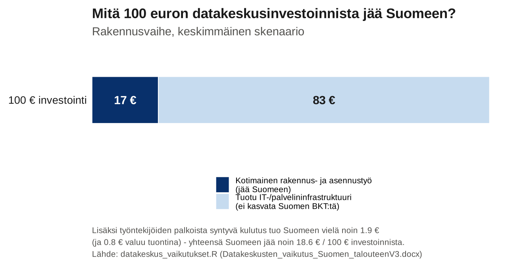

# Datakeskusinvestointien kansantaloudelliset vaikutukset

*Luonnos Taloudellisen katsauksen teemaan (keskeneräinen). Kohdat, joissa lukee **\[TÄYDENNETTÄVÄ: …\]**, vaativat työtä.*

Suomeen on ilmoitettu viime vuosina kymmenien miljardien eurojen datakeskusinvestoinnit, mutta niiden vaikutus bruttokansantuotteeseen on selvästi investoinnin kokoa pienempi. Kansainvälisten selvitysten mukaan noin 70–80 % investoinnista on IT-laitteistoa, joka tuodaan ulkomailta, joten Suomen arvonlisäykseen kirjautuu vain kotimaisen työn osuus, kuten rakennus-, asennus- ja suunnittelutyö. Rakentamisen vaikutus on kertaluonteinen, ja käyttövaiheessa suoria työpaikkoja syntyy vähän. Kerrannaisvaikutusten sekä syrjäytymisvaikutusten huomioiminen on hankalaa. Kerrannaisvaikutukset ovat bruttolukuja, joista osa syrjäyttää muuta toimintaa, joten nettovaikutus jää pienemmäksi kuin usein esitetään vaikutusarvioissa.

## 1. Lähtökohta ja rajaus

**Mitä mitataan.** Teemassa arvioidaan datakeskusinvestointien vaikutusta Suomen talouteen kahdella mittarilla: arvonlisäyksellä, joka vastaa BKT-vaikutusta, ja työllisyydellä. Vaikutukset esitetään nettona eli kotimaiselle taloudelle jäävänä osuutena.

**Oletukset datakeskusten määrästä.** Hankekanta perustuu Dataikkunaan, joka kokoaa julkisista lähteistä Suomeen ilmoitetut datakeskushankkeet. Aineistossa on 170 hankeriviä, joka vastaa noin 150 hanketta ja 97 investoijaa. Valmistumisvuosi on tiedossa vain noin puolella riveistä, joten tarkastelu rajataan vuosina 2027–2028 valmistuviksi ilmoitettuihin 44 riviin (42 hanketta), joiden ilmoitettu investointisumma on noin 58 mrd. €. Näistä 15 hanketta (noin 28 mrd. €) on aloitettu, ja oletuksena on, että aloitetut viedään loppuun. Muiden hankkeiden oletetaan toteutuvan vaiheen mukaan: esiselvitysvaiheessa olevista 0–5 %, suunnitteluvaiheessa olevista 5–15 % ja investointipäätöksen tehneistä mutta aloittamattomista 15–40 %. Oletukset ovat omia, mutta ne on asetettu samaan suuntaan kuin parhaiten saatavilla oleva vertailutieto. Näillä oletuksilla vuosina 2027–2028 valmistuvien hankkeiden investointi on noin 31–36 mrd. € (keskimmäinen arvio noin 33 mrd. €), mikä vastaisi mallin Googlen Haminan datakeskuksen toteutuneeseen sähkötehoon kalibroidulla suhdeluvulla (noin 101 MW / mrd. €) noin 3 100–3 650 megawatin sähkötehoa (keskimmäinen arvio noin 3 340 MW). Summat sisältävät IT-laitteet ja osin estimoituja arvoja (noin 18 %), ja ne kuvaavat valmistumisvuoden mukaista kohorttia, ei vuosittaista investointivirtaa.

> [!CAUTION]
> Vain luonnokseen, poistetaan lopullisesta versiosta: Toteutumaoletukset (0–5 %, 5–15 %, 15–40 %) tukeutuvat neljään vertailuhavaintoon. Fingridin oman arvion mukaan noin kymmenesosa sähkön liityntäkyselyistä toteutuu lopulta kapasiteettina – ja esiselvitysvaihe on tätäkin liityntävaihetta aikaisempi, joten sille asetettu 0–5 % on perusteltua pitää Fingridin lukuakin varovaisempana. Myös kansainväliset liityntäjonotilastot tukevat varovaisuutta: Yhdysvalloissa Lawrence Berkeley National Laboratoryn mukaan vain noin 13 % vuosien 2000–2019 liityntähakemuksista oli edennyt kaupalliseen käyttöön vuoteen 2024 mennessä, ja verkko-operaattorit PJM ja AEP Ohio ovat sitovan maksuvelvoitteen käyttöönoton jälkeen hyväksyneet enää 57 % ja 43 % ilmoitetusta kuormasta. Tämä jälkimmäinen vaihe vastaa lähinnä investointipäätösvaihetta, jolle on silti asetettu tätäkin matalampi, 15–40 %:n haarukka. Lisäksi varovaisuutta tukevat tuoreet Suomi-kohtaiset signaalit: viranomainen määräsi lokakuussa 2026 pysäyttämään työt kahdella Googlen datakeskustontilla kesken olevan ympäristölupaprosessin vuoksi, ja hallitus perui syyskuussa 2026 suunnitellun datakeskustuen.

**Rajaus.** Teemassa ei oteta huomioon tutkimus-, kehitys- ja osaamisvaikutuksia, koska niistä ei ole luotettavaa näyttöä. Datakeskushankkeet valmistuvat usein vaiheittain, ja koko hankkeen kaikkien vaiheiden valmistuminen voi ajoittua selvästi myöhemmäksi kuin ensimmäisen vaiheen valmistuminen, jolloin rakennusvaiheen kokonaisvaikutus voi todellisuudessa jakautua tässä oletettua kaksivuotista rakennusaikaa pidemmälle ajanjaksolle. Yksinkertaistuksena on kuitenkin oletettu, että hankkeen maanrakennus- ja perustustyöt tehdään valmiiksi jo hankkeen alkuvaiheessa koko investointia – myös myöhempiä vaiheita – varten, eivätkä ne siis toistu jokaisen myöhemmän vaiheen yhteydessä.

**Brutto ja netto.** Brutto tarkoittaa koko vaikutusta ennen vähennyksiä. Netto on se osa, joka jää kotimaiselle taloudelle, kun tuonti, palautukset ja muualta siirtyvä toiminta on vähennetty.

| Mittari | Brutto | Netto |
| --- | --- | --- |
| BKT-vaikutus | Investoinnin koko (I) tai kaikki kerrannaisvaikutukset | Kotimainen arvonlisä: investointi miinus tuonti (I − M) |
| ALV | Koko ketjussa kertyvä vero | Valtion jäljelle jäävä vero palautusten jälkeen (lähellä nollaa) |
| Työllisyys | Kaikki hankkeen tukemat työpaikat | Uudet työpaikat, kun vähennetään muualta siirtyneet |
| Kulutus | Kaikkien työntekijöiden palkoista syntyvä kulutus | Vain uusi kulutus, kun huomioidaan syrjäytyminen ja muualle menevät palkat |

## 2. Vaikutus kotimaahan

Datakeskusinvestoinnin hyöty Suomen kansantaloudelle ei synny koko investoinnin summasta, vaan vain siitä osasta, joka jää kotimaahan. Noin kolme neljäsosaa rahasta kuluu palvelimiin ja muihin IT-laitteisiin, jotka tuodaan lähes kokonaan ulkomailta eivätkä siis kasvata Suomen bruttokansantuotetta sen enempää kuin minkä tahansa muun tuontitavaran ostaminen. Suomeen jää käytännössä kaksi asiaa: rakennus- ja asennustyön arvo sekä se, mitä työntekijät kuluttavat palkoistaan Suomessa. Näiden kahden yhteisvaikutus on karkeasti joka viides investoitu euro.

Kun tämä suhdeluku lasketaan R-mallilla ja sovelletaan siihen, että vain osa ilmoitetuista hankkeista todennäköisesti todella toteutuu, vuosina 2027–2028 valmistuvien datakeskusten rakentaminen kasvattaisi Suomen bruttokansantuotetta yhteensä noin 6,1 mrd. € (vaihteluväli noin 3,3–7,8 mrd. €) — eli keskimäärin noin 3 mrd. € vuodessa.

## 3. Rakennusvaihe ja käyttöönotto

Rakennusvaiheen vaikutus on kertaluonteinen ja kasautuu hankkeiden valmistumisvuosille 2027–2028. Käyttövaiheen vaikutus sen sijaan on pysyvä: se jatkuu niin kauan kuin datakeskukset ovat käytössä, mutta on vuositasolla selvästi pienempi kuin rakentamisen kertaluonteinen piikki. Dataikkunan hankkeiden valmistuminen painottuu vuosiin 2027–2028, joten rakennusvaiheen vaikutus voi heiketä nopeasti, ellei uusia hankkeita käynnisty.

**Rakennusvaihe.** Työllisyysvaikutus koko rakennusajalta on yhteensä noin 40 600 henkilötyövuotta (vaihteluväli 38 200–44 300), joista suoria rakennus- ja asennustyöpaikkoja noin 18 400. Verotuloja (yhteisövero, arvonlisävero, tulovero ja kiinteistövero yhteensä) kertyy koko rakennusajalta noin 1,1 mrd. € (vaihteluväli 0,7–1,7 mrd. €). Arvonlisäys eli BKT-vaikutus on noin 6,1 mrd. € (vaihteluväli 3,3–7,8 mrd. €).

**Käyttövaihe.** Datakeskukset työllistävät suoraan vähän (aineiston mediaani on 0,76 pysyvää työpaikkaa megawattia kohti), ja käyttökustannuksista suuri osa on sähköä. Valmiina ollessaan hankekanta tuottaisi vuosittain toistuvan työllisyysvaikutuksen, joka on yhteensä noin 6 000 henkilötyövuotta (vaihteluväli 2 800–9 900), joista suoraan datakeskusten omaa ylläpito- ja käyttöhenkilöstöä noin 2 750. Verotuloja (samat erät kuin rakennusvaiheessa, lisäksi sähkövero) kertyy vuosittain noin 0,7 mrd. € (vaihteluväli 0,56–0,91 mrd. €). Arvonlisäys on noin 2,0 mrd. € vuodessa (vaihteluväli 1,2–2,8 mrd. €).

| Netto | Rakennusvaihe 2027–2028 (kumulatiivinen) | Käyttövaihe (vuosittain) |
| --- | --- | --- |
| Arvonlisäys (BKT-vaikutus) | noin 6,1 mrd. € (3,3–7,8) | noin 2,0 mrd. €/v (1,2–2,8) |
| Työllisyys | noin 40 600 htv (38 200–44 300), josta suoria n. 18 400 | noin 6 000 htv/v (2 800–9 900), josta suoria n. 2 750 |
| Verotulot yhteensä¹ | noin 380 milj. € (252–538) | noin 0,7 mrd. €/v (0,56–0,91) |
| &nbsp;&nbsp;– Yhteisövero | noin 116 milj. € (65–180) | noin 25 milj. €/v (14–39) |
| &nbsp;&nbsp;– Arvonlisävero (netto) | noin 91 milj. € (52–135) | noin 19 milj. €/v (8–33) |
| &nbsp;&nbsp;– Tulovero¹ | noin 114 milj. € (89–145) | noin 55 milj. €/v (21–110) |
| &nbsp;&nbsp;– Kiinteistövero | noin 60 milj. € (47–78) | noin 60 milj. €/v (47–78) |
| &nbsp;&nbsp;– Sähkövero | – | noin 564 milj. €/v (467–651) |

¹ Tulovero sisältää vain suorien työntekijöiden palkoista kertyvän tuloveron, ei epäsuorien tai indusoitujen työntekijöiden tuloveroa. Verotulot yhteensä -luku on siis tältä osin aliarvio.

## 4. Vaikutus muuhun rakentamiseen: sähköverkot

Datakeskukset lisäävät sähkönkulutusta ja kantaverkkoinvestointeja. Fingrid suunnittelee investoivansa noin 5,2 mrd. € vuoteen 2035 mennessä (noin 2,0 mrd. € vuosina 2025–2028), mutta suunnitelma ei erittele investointeja asiakastyypeittäin, joten datakeskusten osuutta ei voi lukea siitä suoraan. Noin puolet noin 70 GW:n kulutuksen liityntäkyselyistä liittyy datakeskuksiin, ja Fingridin arvion mukaan realistisesti noin kymmenesosa kyselyistä toteutuu, mikä tarkoittaisi noin 5 GW:n lisäystä kulutukseen.

Datakeskusten kasvava sähkönkulutus edellyttää myös uutta tuotantokapasiteettia, josta merkittävä osa rakennetaan Suomessa tuulivoimana – osin suoraan datakeskusyhtiöiden pitkäaikaisten sähkönostosopimusten (PPA) turvin. Teema ei kuitenkaan sisällytä tuulivoimainvestointeja tarkasteluun: niitä ei voi erottaa luotettavasti muusta, datakeskuksista riippumattomasta tuulivoimarakentamisesta, eikä niitä voi laskea yhteen datakeskusten omien pääomamenojen kanssa ilman kaksoislaskentaa, koska osa yhtiöiden (esim. Googlen) ilmoittamista investointisummista sisältää jo omia energiahankkeitaan.

## 5. Kerrannais- ja syrjäyttämisvaikutukset

Laskelma sisältää kerrannaisvaikutuksena vain palkoista syntyvän kulutuksen, eikä se oleta laajempia toimittajaketjun kerrannaisvaikutuksia, joiden suuruudesta ei ole luotettavaa tietoa. Syrjäyttämistä voi syntyä kolmen kanavan kautta: työvoima, sähköverkon kapasiteetti ja sähkön hinta. Rakennusalan heikko tilanne vähentää työvoiman syrjäytymistä, mutta Etelä-Suomen liityntärajoitukset (poistuvat asteittain vuosina 2027–2029) rajoittavat samalla muita sähkön suurkuluttajia. **\[TÄYDENNETTÄVÄ: sähkön hinta ja kotitalouksien ostovoima.\]**

## 6. Yhteenveto

Datakeskusinvestoinneista noin kymmenesosa–viidennes näkyy Suomen BKT:ssä, ja rakennusvaiheessa vaikutus on kertaluonteinen. Käyttövaiheen vaikutus on pysyvä mutta työllisyydeltään vähäinen. Suurimmat epävarmuudet ovat hankkeiden toteutuminen, ajoitus ja syrjäyttäminen. **\[TÄYDENNETTÄVÄ: viimeistele, kun käyttövaiheen luvut on laskettu.\]**

## Liite: Laskentakaavat

**Merkinnät:** *inv* = investointi (mrd. €), *s* = skenaario (alhainen/keskimääräinen/korkea), *k* = *inv* / 12 (skaalauskerroin muistion 12 mrd. €:n peruslukuihin).

### Työllisyys

- **Rakennusvaihe, suora+epäsuora+indusoitu yhteensä:** rak_htv = *inv* × 1 231 htv/mrd. € (Googlen oma ilmoitus, sama kaikissa skenaarioissa)
  - *josta suoria:* rak_htv × 1 / 2,2 (Googlen Deloitte-selvityksen Hamina-suhde: epäsuora+indusoitu = 1,2 × suora)
- **Käyttövaihe, suora+epäsuora+indusoitu, vuodessa:** kaytto_htv = *inv* × kaytto_htv_per_mrd[s], jossa kaytto_htv_per_mrd = (kaytto_suorat_12[s] / 12) × 2,2
  - *josta suoria (vuodessa):* suorat_htv = *k* × kaytto_suorat_12[s] (500 / 1 000 / 1 500 per 12 mrd. €)

### Arvonlisäys (BKT-vaikutus)

**Rakennusvaihe** (koko rakennusajalta): BKT_rak = I + C_rak − M_inv − M_C_rak

- I = *inv* × 1 000 (investointi, M€)
- kotim = I × kotimainen_osuus[s] (12 / 20,8 / 23 %) — kotimaisen toimitusketjun laskutusosuus
- M_inv = (I − kotim) + kotim × kotim_tuontisisalto[s] — tuonti (IT-laitteet + kotimaisten urakoiden tuontisisältö)
- rak_palkat = rak_htv × 45 000 € / 1 000 000 (keskipalkka)
- kotim_palkkaosuus = suomalaisten_osuus[s] + (1 − suomalaisten_osuus[s]) × ulkom_kulutussuhde[s] (0,5/0,6/0,7 ja 0,5)
- C_rak = rak_palkat × kulutusosuus[s] × kotim_palkkaosuus — palkoista syntyvä kotimainen kulutus
- M_C_rak = C_rak × kulutus_tuontisisalto[s] (30 %) — kulutuksen tuontisisältö

**Käyttövaihe** (vuodessa): BKT_kaytto = X + C_kaytto − M_sahko − M_C_kaytto

- mw = *inv* × mw_per_mrd[s] (101 MW/mrd. €, Haminaan kalibroitu)
- sahko_mwh = mw × kayttoaste[s] × 8 760 h (0,75/0,85/0,90 käyttöaste)
- sahkokulut = sahko_mwh × sahkon_hinta[s] / 1 000 000
- henkilosto = suorat_htv × 100 000 € / 1 000 000 (henkilöstökulu per suora työntekijä)
- opex = sahkokulut + henkilosto
- X = opex × (1 + voittolisa[s]) — palveluvienti emoyhtiölle, siirtohinnoittelun cost-plus-kaava (0,06/0,07/0,08 voittolisä)
- M_sahko = sahkokulut × tuontisahko_osuus[s] (0,15/0,10/0,05)
- C_kaytto = *k* × (kaytto_palkat_suorat_12[s] + kaytto_palkat_epasuor_12[s]) × kulutusosuus[s]
- M_C_kaytto = C_kaytto × kulutus_tuontisisalto[s]

### Verotulot

**Rakennusvaihe** (koko rakennusajalta):

- Yhteisövero = *k* × rak_yhteisovero_12[s] — urakoitsijoiden ja toimittajien liikevoitosta
- Arvonlisävero (netto) = *k* × rak_alv_12[s] — työntekijöiden kulutuksen ALV, investoinnin oma ALV palautuu
- Tulovero = *k* × rak_tulovero_12[s] — ks. tarkempi laskentaperuste alla
- Kiinteistövero = kiinteistovero_v × rak_kiinteistovero_os (0,5) × rakennusvuodet (2)
- Sähkövero = 0

**Käyttövaihe** (vuodessa):

- Yhteisövero = opex × voittolisa[s] × 20 % (yhteisöveroaste)
- Arvonlisävero (netto) = *k* × kaytto_alv_12[s]
- Tulovero = *k* × kaytto_tulovero_12[s] — ks. tarkempi laskentaperuste alla
- Kiinteistövero = kiinteistovero_v = *k* × verotusarvo_12[s] × kiinteistoveropros[s]
- Sähkövero = sahko_mwh × 22,66 €/MWh / 1 000 000

**Tulovero, tarkempi laskentaperuste (molemmat vaiheet):** suorien työntekijöiden määrä × keskipalkka → verotettava tulo/työntekijä = 91,8 % × bruttopalkka − 750 € → valtion tulovero vuoden 2026 progressiivisella tuloveroasteikolla + kunnallisvero 7,57 % verotettavasta tulosta → kerrotaan Suomessa verotettujen osuudella (rakennusvaihe: suomalaisten_osuus 50/60/70 %; käyttövaihe: ei erillistä oletusta, 100 %).

## Liite: Kaavat sovellettuna tämän teeman lukuihin (31/33/36 mrd. €)

Alla samat kaavat auki laskettuina tämän teeman omalla toteutumapainotetulla hankekannalla, jotta jokainen tekstissä esiintyvä luku on jäljitettävissä. *k* = *inv* / 12.

### Alhainen (investointi 31 mrd. €, *k* = 2,583)

**Työllisyys**
- rak_htv = 31 × 1 231 = 38 161 htv → suorat = 38 161 × 1/2,2 = 17 346 htv
- kaytto_htv = 31 × 91,67 = 2 842 htv/v → suorat_htv = 2,583 × 500 = 1 292 htv/v

**Arvonlisäys**
- I = 31 × 1 000 = 31 000 M€; kotim = 31 000 × 12 % = 3 720 M€; M_inv = (31 000 − 3 720) + 3 720 × 25 % = 28 210 M€
- rak_palkat = 38 161 × 45 000 € / 1 000 000 = 1 717,2 M€; kotim_palkkaosuus = 0,50 + 0,50 × 0,50 = 0,75
- C_rak = 1 717,2 × 60 % × 0,75 = 772,8 M€; M_C_rak = 772,8 × 30 % = 231,8 M€
- **BKT_rak = 31 000 + 772,8 − 28 210,0 − 231,8 = 3 330,9 M€ ≈ 3,3 mrd. €**
- mw = 31 × 101,25 = 3 139 MW; sahko_mwh = 3 139 × 0,75 × 8 760 h = 20,62 TWh; sahkokulut = 20,62 TWh × 50 €/MWh = 1 031,1 M€
- henkilosto = 1 292 × 100 000 € / 1 000 000 = 129,2 M€; opex = 1 031,1 + 129,2 = 1 160,2 M€; X = 1 160,2 × 1,06 = 1 229,9 M€
- M_sahko = 1 031,1 × 15 % = 154,7 M€; C_kaytto = 2,583 × (72 + 86,4) × 60 % = 245,5 M€; M_C_kaytto = 245,5 × 30 % = 73,7 M€
- **BKT_kaytto = 1 229,9 + 245,5 − 154,7 − 73,7 = 1 247,1 M€/v ≈ 1,2 mrd. €/v**

**Verotulot, rakennusvaihe**
- Yhteisövero = 2,583 × 25 = 64,6 M€; ALV = 2,583 × 20 = 51,7 M€
- Tulovero: 17 346 suorasta Suomessa verotettuja 50 % → 8 673 htv × 10 287 €/htv = 2,583 × 34,5 = **89,2 M€**
- Kiinteistövero = 46,5 × 0,5 × 2 = 46,5 M€; Sähkövero = 0
- **Yhteensä = 252,0 M€**

**Verotulot, käyttövaihe (vuodessa)**
- Yhteisövero = 1 160,2 × 0,06 × 20 % = 13,9 M€; ALV = 2,583 × 3 = 7,8 M€; Tulovero = 2,583 × 8,0 = 20,7 M€
- Kiinteistövero = 2,583 × 1 500 × 1,20 % = 46,5 M€; Sähkövero = 20,62 TWh × 22,66 €/MWh = 467,3 M€
- **Yhteensä = 556,1 M€/v**

### Keskimääräinen (investointi 33 mrd. €, *k* = 2,750)

**Työllisyys**
- rak_htv = 33 × 1 231 = 40 623 htv → suorat = 40 623 × 1/2,2 = **18 465 htv** ("≈ 18 400")
- kaytto_htv = 33 × 183,33 = **6 050 htv/v** → suorat_htv = 2,750 × 1 000 = **2 750 htv/v**

**Arvonlisäys**
- I = 33 × 1 000 = 33 000 M€; kotim = 33 000 × 20,83 % = 6 875,0 M€; M_inv = (33 000 − 6 875,0) + 6 875,0 × 20 % = 27 500,0 M€
- rak_palkat = 40 623 × 45 000 € / 1 000 000 = 1 828,0 M€; kotim_palkkaosuus = 0,60 + 0,40 × 0,50 = 0,80
- C_rak = 1 828,0 × 62,5 % × 0,80 = 914,0 M€; M_C_rak = 914,0 × 30 % = 274,2 M€
- **BKT_rak = 33 000 + 914,0 − 27 500,0 − 274,2 = 6 139,8 M€ ≈ 6,1 mrd. €**
- mw = 33 × 101,25 = 3 341 MW; sahko_mwh = 3 341 × 0,85 × 8 760 h = 24,88 TWh; sahkokulut = 24,88 TWh × 60 €/MWh = 1 492,7 M€
- henkilosto = 2 750 × 100 000 € / 1 000 000 = 275,0 M€; opex = 1 492,7 + 275,0 = 1 767,7 M€; X = 1 767,7 × 1,07 = 1 891,5 M€
- M_sahko = 1 492,7 × 10 % = 149,3 M€; C_kaytto = 2,750 × (84 + 100,8) × 62,5 % = 317,6 M€; M_C_kaytto = 317,6 × 30 % = 95,3 M€
- **BKT_kaytto = 1 891,5 + 317,6 − 149,3 − 95,3 = 1 964,5 M€/v ≈ 2,0 mrd. €/v**

**Verotulot, rakennusvaihe**
- Yhteisövero = 2,750 × 42 = 115,5 M€; ALV = 2,750 × 33 = 90,8 M€
- Tulovero: 18 465 suorasta Suomessa verotettuja 60 % → 11 079 htv × 10 287 €/htv = 2,750 × 41,4 = **114,0 M€**
- Kiinteistövero = 60,2 × 0,5 × 2 = 60,2 M€; Sähkövero = 0
- **Yhteensä = 380,4 M€ ("≈ 380 milj. €")**

**Verotulot, käyttövaihe (vuodessa)**
- Yhteisövero = 1 767,7 × 0,07 × 20 % = 24,7 M€; ALV = 2,750 × 7 = 19,2 M€; Tulovero = 2,750 × 20,1 = 55,3 M€
- Kiinteistövero = 2,750 × 1 750 × 1,25 % = 60,2 M€; Sähkövero = 24,88 TWh × 22,66 €/MWh = 563,8 M€
- **Yhteensä = 723,2 M€/v ("≈ 0,7 mrd. €/v")**

### Korkea (investointi 36 mrd. €, *k* = 3,000)

**Työllisyys**
- rak_htv = 36 × 1 231 = 44 316 htv → suorat = 44 316 × 1/2,2 = 20 144 htv
- kaytto_htv = 36 × 275,00 = 9 900 htv/v → suorat_htv = 3,000 × 1 500 = 4 500 htv/v

**Arvonlisäys**
- I = 36 × 1 000 = 36 000 M€; kotim = 36 000 × 23 % = 8 280,0 M€; M_inv = (36 000 − 8 280,0) + 8 280,0 × 15 % = 28 962,0 M€
- rak_palkat = 44 316 × 45 000 € / 1 000 000 = 1 994,2 M€; kotim_palkkaosuus = 0,70 + 0,30 × 0,50 = 0,85
- C_rak = 1 994,2 × 65 % × 0,85 = 1 101,8 M€; M_C_rak = 1 101,8 × 30 % = 330,5 M€
- **BKT_rak = 36 000 + 1 101,8 − 28 962,0 − 330,5 = 7 809,3 M€ ≈ 7,8 mrd. €**
- mw = 36 × 101,25 = 3 645 MW; sahko_mwh = 3 645 × 0,90 × 8 760 h = 28,74 TWh; sahkokulut = 28,74 TWh × 70 €/MWh = 2 011,6 M€
- henkilosto = 4 500 × 100 000 € / 1 000 000 = 450,0 M€; opex = 2 011,6 + 450,0 = 2 461,6 M€; X = 2 461,6 × 1,08 = 2 658,5 M€
- M_sahko = 2 011,6 × 5 % = 100,6 M€; C_kaytto = 3,000 × (96 + 115,2) × 65 % = 411,8 M€; M_C_kaytto = 411,8 × 30 % = 123,6 M€
- **BKT_kaytto = 2 658,5 + 411,8 − 100,6 − 123,6 = 2 846,2 M€/v ≈ 2,8 mrd. €/v**

**Verotulot, rakennusvaihe**
- Yhteisövero = 3,000 × 60 = 180,0 M€; ALV = 3,000 × 45 = 135,0 M€
- Tulovero: 20 144 suorasta Suomessa verotettuja 70 % → 14 101 htv × 10 287 €/htv = 3,000 × 48,4 = **145,1 M€**
- Kiinteistövero = 78,0 × 0,5 × 2 = 78,0 M€; Sähkövero = 0
- **Yhteensä = 538,0 M€**

**Verotulot, käyttövaihe (vuodessa)**
- Yhteisövero = 2 461,6 × 0,08 × 20 % = 39,4 M€; ALV = 3,000 × 11 = 33,0 M€; Tulovero = 3,000 × 36,5 = 109,5 M€
- Kiinteistövero = 3,000 × 2 000 × 1,30 % = 78,0 M€; Sähkövero = 28,74 TWh × 22,66 €/MWh = 651,2 M€
- **Yhteensä = 911,1 M€/v**

---

## Avoimet kohdat (poistetaan ennen julkaisua)

- Googlen kapasiteetti: Dataikkunan oma imputoitu kapasiteetti (325 MW/rivi) on todennäköisesti liian suuri, eikä sitä ole käytetty teemassa. Luvussa 1 mainittu MW-luku on sen sijaan laskettu mallin omalla, Haminan datakeskuksen toteutuneeseen tehoon kalibroidulla suhdeluvulla (101 MW/mrd. €) — tarkista, hyväksytäänkö tämä laskentatapa vai jätetäänkö MW-luku kokonaan pois.
- Kohortti vs. vuosivirta: aloitettujen hankkeiden rahaa on jo käytetty ennen vuotta 2027, joten investointi ei jakaudu vain valmistumisvuodelle.
- Lähteet ja luvut, tarkistuksen tilanne ennen julkaisua:
  - **Vahvistettu:** Fingridin oma elokuun 2026 tiedote vahvistaa 2025–2028 investoinnin olevan n. 2,0 mrd. €, kuten teemassa; datakeskukset mainitaan nimeltä kasvun ajurina.
  - **Ei vielä vahvistettu, tarkistettava alkuperäisestä PDF:stä:** koko 2026–2035 kauden 5,2 mrd. € -kokonaissumma (hakutuloksista ei löytynyt suoraa vahvistusta, mutta ei myöskään ristiriitaa).
  - **Ei löytynyt hausta, etsittävä uudelleen:** tarkka "Yle 10.4.2026" -lähde 10 %:n toteutumisarviolle. Fingridin elokuun 2026 tiedote toteaa kuitenkin saman suuntaisesti, että jos kaikki liittymissopimukset toteutuisivat, ne kasvattaisivat Suomen sähkönkulutusta lähes 40 % vuoden 2025 tasosta – eli spekulatiivista ylikysyntää liityntäjonossa on paljon, mikä tukee karkeasti samaa johtopäätöstä.
  - Dataikkuna (osa summista imputoitu), IoT Analytics ja IMPLAN (IT-laitteiden osuus), Lawrence Berkeley National Laboratoryn liityntäjonotilasto, PJM:n ja AEP Ohion jonotilastot, uutisoinnit Googlen datakeskustyömaiden pysäyttämisestä ja datakeskustuen perumisesta: linkit on koottu pääasiakirjan (Datakeskusten_vaikutus_Suomen_talouteenV3.docx) Lähteet-listaan, tarkista sieltä ennen julkaisua.
